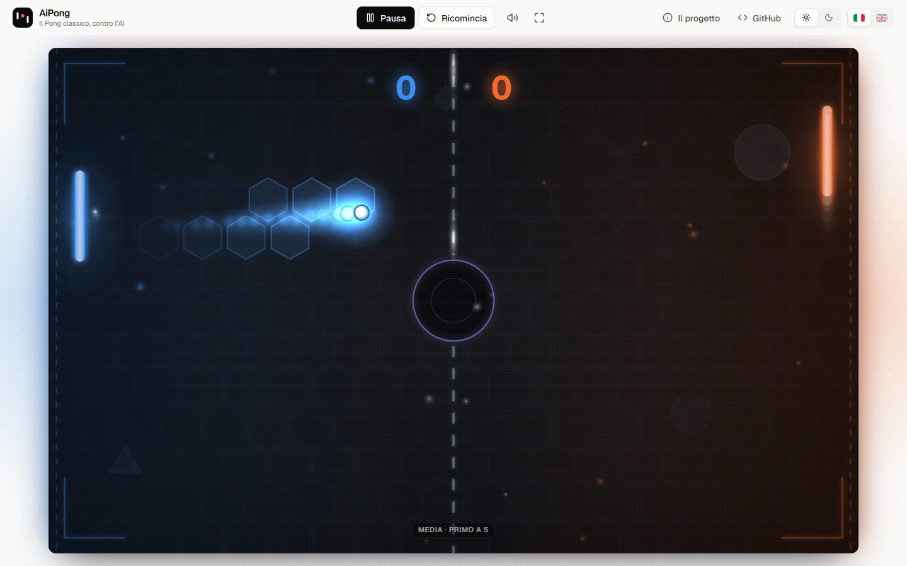
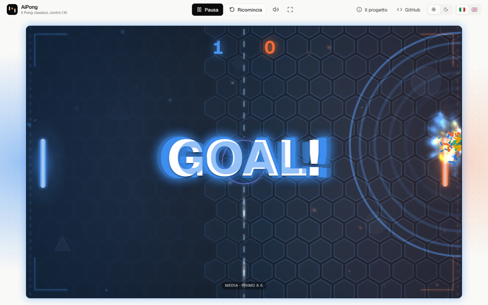
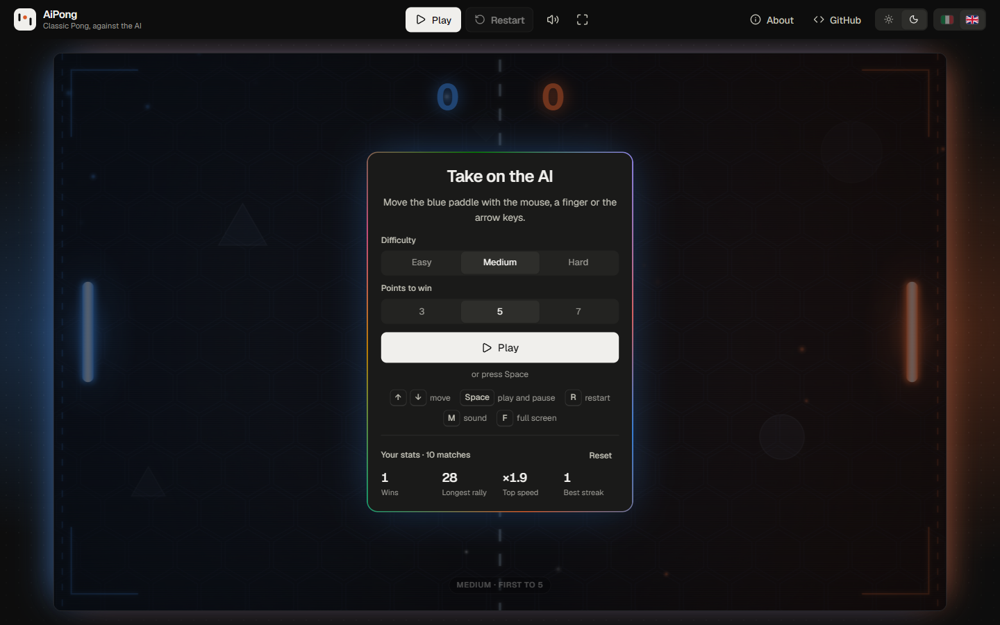
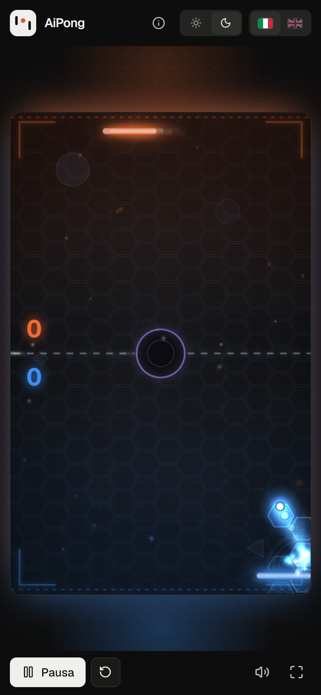

# AiPong

**Classic Pong in the browser, against an AI that plays like a person.**

**[Play it → alexzaccaria.github.io/AiPong](https://alexzaccaria.github.io/AiPong/)**

The computer's paddle reacts a moment late, aims a little off and, below the hard level, only sees
a bounce off the wall coming when the ball is close. The match is played in a neon arena: glowing
paddles and trails, sparks and shockwaves on every hit, "GOAL!" with a five-wave explosion, a ball
on fire at top speed, fireworks for a win, and synthesised arcade sounds. Mouse, keyboard or a
finger; on a phone held upright the field turns and your paddle sits under your thumb. Italian and
English, light and dark, stats kept in the browser.

No framework, no dependencies, no build: the browser loads the ES modules as they are written,
and the `web/` folder is the whole site, published as it is.

| A rally (light, Italian) | "GOAL!" (light, Italian) |
|---|---|
|  |  |
| **Menu and stats (dark, English)** | **On a phone held upright (dark, Italian)** |
|  |  |

## Highlights

- **An opponent that plays like a person.** It looks at the ball only every `reaction` seconds,
  picks a slightly wrong spot each time the ball comes its way, moves at a limited speed, and only
  the hard level works out bounces off the walls in advance. The three levels were tuned by
  simulation: against a player who reaches every ball, the AI returns on average about 4 (easy),
  7 (medium) and 14 (hard) shots before missing one, and a test keeps that order.
- **Fixed-step physics in field units.** The match advances 120 steps per second whatever the
  display (60, 120 or 144 Hz play the same) and drawing interpolates between steps. Sizes and
  speeds are in units of a 160 × 100 field, so the ball crosses it in the same time on a phone
  and on a 27" monitor; the canvas follows the screen's pixel density.
- **Rallies that speed up, shots you can shape.** Every hit makes the ball 5% faster, up to three
  times the serve speed (about 23 hits) at every level; where it meets the paddle sets the angle,
  and the paddle's own movement at that moment adds spin.
- **A neon arena.** Each half is lit in its side's colour, with goal lines and corner brackets to
  match; the ball waits for the serve in a centre circle, violet, while a timer ring fills up. The
  hexagonal floor lights up under the ball, glowing paddles and the ball cast light on it, a pulse
  of energy runs along the net and motes drift in the light. The ball's halo takes the colour of
  the last paddle that hit it; light trails and a short phosphor afterglow follow everything that
  moves, with speed streaks and a spinning ring on a fast ball. Every hit throws sparks and a
  shockwave, lights up the floor around it and shakes the screen, harder the faster the ball
  (wall bounces and points too); every fifth hit of a rally is a golden milestone; above 80% of
  its top speed the ball catches fire, sheds embers and makes the whole arena tremble. A point
  brings "GOAL!" in the scorer's colour with the five-wave explosion of the first AiPong (burst,
  second burst, sparkles, confetti, a shower of glitter), a wave of lit cells sweeping the floor
  from the edge the ball crossed, an arena flash and the score lighting up; a win ends in
  confetti and fireworks. Around the arena, a dot grid and one light
  per side that breathes and flares when its paddle hits or scores. The arena is dark in both
  themes, and every delayed wave runs on the game clock, so a pause freezes it mid-air.
- **Synthesised arcade sound.** Square-wave hits whose pitch rises with the ball's speed, the angle
  of the shot and the length of the rally, a fanfare for your points, sawtooth notes for the AI's,
  chimes for rally milestones: all generated with the Web Audio API, scheduled on the audio clock
  and levelled by a compressor, with no audio file.
- **Time belongs to the match.** Serves and the pause after a point are counted in game time inside
  the match's state machine: a pause freezes them, and a new match is a new object. The first
  version scheduled them with `setTimeout`, so a pause right after a point froze the match for good
  and a reset during the last point ended the fresh 0–0 with "Computer wins!"; tests cover both.
- **One page, the game.** The arena takes the screen: a single bar on top holds the match
  controls where there is room (wide screens, phones on their side) and the score sits on the
  arena, either side of the net as in the original Pong; on narrow screens the controls move
  under the arena. Full screen covers the whole app, so the controls stay at hand. The start panel
  over the field is the menu: difficulty, points to win, stats and keys. *About* opens in a sheet
  over the game (and pauses it); `#about` links to it.
- **A design system in plain CSS.** Tokens for page, surfaces and ink, a categorical palette with
  its own dark steps, Geist, Lucide icons, cards and segmented controls. The chrome stays
  monochrome and the colour lives in the arena; the panels over it turn the palette into a slowly
  spinning border. Theme and language are set before the first paint, and the theme follows the
  system until one is picked.
- **Accessible.** Playable from the keyboard alone; points, pauses and results are announced in a
  polite live region; keyboard focus follows the panels as they open and close; with *reduce
  motion* there is no shake, trail, afterglow, particle or flash, and "GOAL!" does not pulse; zoom
  is never blocked.
- **Safe by construction.** A Content Security Policy allows only the site's own scripts, styles and
  fonts, and markup is built with a tagged template that escapes every value it is given.

## How a frame works

```
requestAnimationFrame                                    controller.js
  ├─ add the time elapsed (at most 0.1 s: a hidden tab is not caught up)
  ├─ step the match every 1/120 s of it                  game/match.js
  │    ├─ player's paddle   pointer, or the keys while held
  │    ├─ AI's paddle       reaction, aim error, top speed    game/ai.js
  │    └─ ball              walls, paddle faces, points        game/physics.js
  ├─ advance the effects   delayed waves, particles, rings, embers of a ball on fire   render/effects.js
  ├─ drain the match's events
  │    ├─ sounds            synthesised, scheduled on the audio clock   audio.js
  │    ├─ effects           sparks, shockwaves, "GOAL!", milestones, shake
  │    ├─ announcements     polite live region                          ui/live.js
  │    └─ stats             at game over, saved in localStorage         stats.js
  ├─ draw                                                               render/renderer.js
  │    ├─ the cached arena  gradient, side colours, hexagons, goal lines, corners, net,
  │    │                    centre circle, scan lines, vignette;
  │    │                    laid over the last frame at half opacity (the afterglow)
  │    ├─ in field units    motes, lit floor cells, net pulse, floor lights, flash, wall sparks,
  │    │                    trail, speed streaks, paddles, particles and rings
  │    │                    ("lighter" blending, cached glow sprites), ball and serve timer
  │    └─ upright on screen rally counter and speed, "GOAL!"
  └─ update the DOM         only the parts that changed: the score on the arena,
                            the stage lights behind it                       ui/play-view.js
```

## Stack

| Layer | Choice |
|---|---|
| Page | HTML, CSS (cascade layers, nesting, container queries), JavaScript ES modules; no framework, no build |
| Game | Canvas 2D, Web Audio API, Pointer Events, Fullscreen API |
| Design | CSS design tokens and components, Geist (self-hosted), Lucide icons (inlined) |
| Tests | `node:test`, Node.js ≥ 22 |
| Hosting | GitHub Pages, published by a GitHub Actions workflow after the tests |

## Getting started

```sh
npm start     # http://localhost:4400, served by tools/serve.js (no dependencies)
npm test      # physics, AI, match, stats, settings, translations
```

There is nothing to install. Opening `web/index.html` straight from the disk does not work:
browsers don't load ES modules from `file://`, so any static server will do (`PORT=8080 npm start`
for another port).

## Publishing

`web/` is the whole site, served as it is: there is nothing to build, and every path is relative,
so it works under GitHub Pages' `/AiPong/`. The workflow `.github/workflows/pages.yml` runs at every
push to `main` that changes `web/`, `test/`, `package.json` or the workflow itself: it runs
`npm test` and, if every test passes, uploads `web/` and deploys it. A push that only touches the
README, the docs or the licence publishes nothing.

```
push to main
  ├─ test      checkout · Node LTS · npm test
  └─ deploy    after test: configure-pages · upload-pages-artifact (web/) · deploy-pages
```

Once, in the repository: *Settings → Pages → Build and deployment → Source: GitHub Actions*. The
workflow can also be started by hand from the *Actions* tab. The Content Security Policy is a
`<meta>` tag in `web/index.html`, so it travels with the files; GitHub Pages adds no custom headers.

## Project structure

```
AiPong/
  ├─ web/                        the site, published as it is
  │    ├─ index.html             header, stage, About sheet; CSP
  │    ├─ css/app.css            design tokens, components, layout
  │    ├─ fonts/                 Geist (OFL)
  │    └─ js/
  │         ├─ boot.js           theme and language before the first paint
  │         ├─ main.js           wires the page together
  │         ├─ project.js        author and repository address, in one place
  │         ├─ controller.js     the loop, events, actions
  │         ├─ input.js          mouse, touch, keyboard
  │         ├─ audio.js          synthesised sounds
  │         ├─ stats.js · settings.js · store.js
  │         ├─ game/             no DOM: config, physics, AI, match, seeded random
  │         ├─ render/           canvas renderer, effects, hexagonal floor
  │         ├─ i18n/             it (reference shape), en
  │         └─ ui/               play view, About, segmented control, preferences, icons, html
  ├─ test/                       node:test suites
  ├─ tools/serve.js              static server for development
  ├─ docs/                       screenshots
  ├─ .github/workflows/pages.yml tests, then publishing on GitHub Pages
  └─ LICENSE                     MIT
```

## Scripts

| Command | What it does |
|---|---|
| `npm start` | Serves `web/` on http://localhost:4400 |
| `npm test` | Runs every suite in `test/` with `node:test` (the workflow runs it before publishing) |

## Privacy

Nothing leaves the browser: the page makes no network request beyond its own files. Settings,
stats, theme, language and sound are kept in `localStorage` under the `aipong.*` keys; *Reset* in
the stats panel clears the stats.

## About the project

AiPong started in 2025 as a prototype, a single 1,600-line JavaScript file. It worked, with the
limits of a prototype; it was then rewritten from scratch as a portfolio piece, in small modules,
with the physics, the opponent and the match tested in Node.

## License

[MIT](LICENSE). Third-party assets keep their own licences: Geist under the SIL Open Font License
(`web/fonts/OFL.txt`), Lucide icons under the ISC licence (notice in `web/js/ui/icon-paths.js`).
